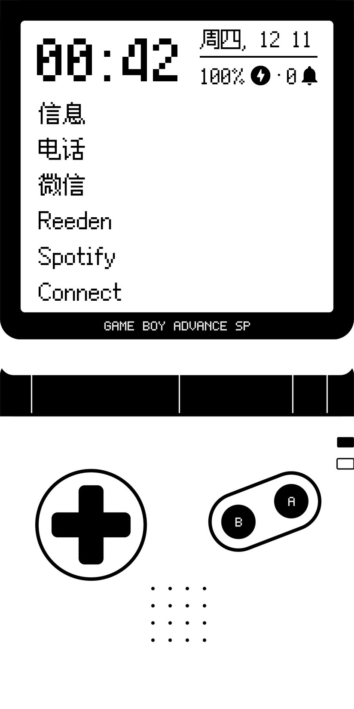
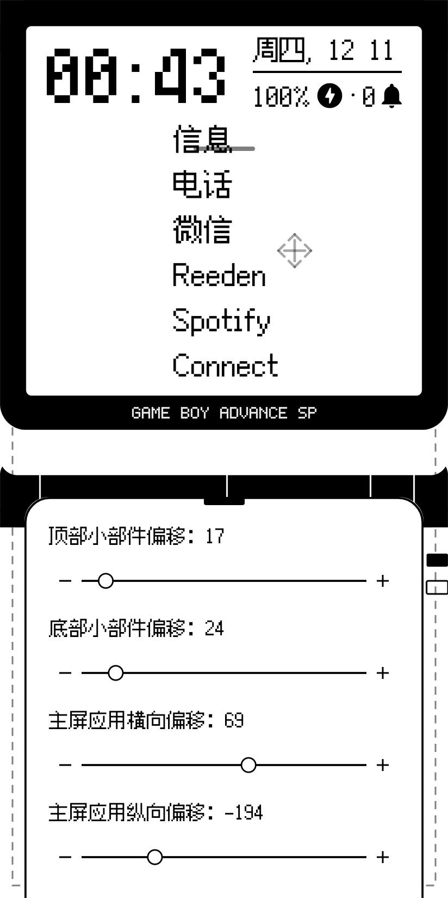
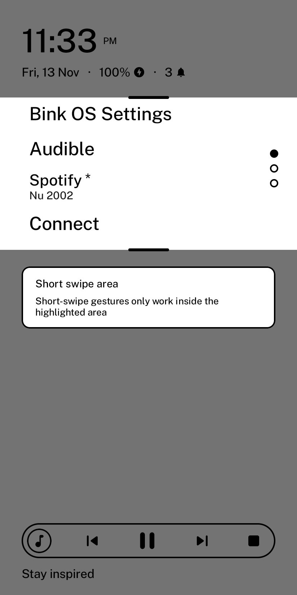
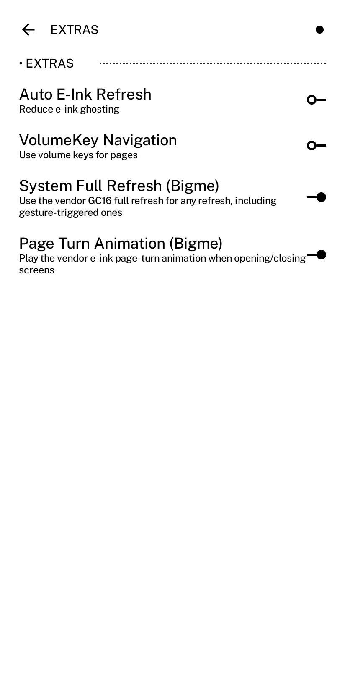
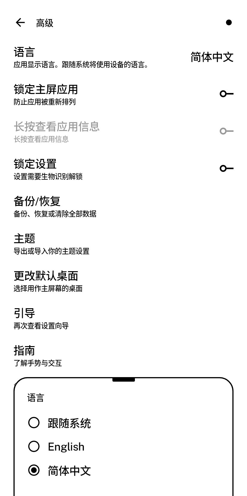

<div align="center">
  
  <h1>Bink OS</h1>
  <p><b>A text-first, e-ink tuned Android launcher for the Bigme HiBreak.</b><br>
  A personal fork of <a href="https://github.com/gezimos/inkOS">inkOS</a>, tuned so the HiBreak feels native.</p>
  <p>
    <a href="https://github.com/MercShen/BinkOS/releases">Download APK</a> ·
    <a href="DOCUMENTATION.md">Documentation</a>
  </p>
  <table>
    <tr>
      <td align="center">
        <br>
        <sub>Text-first home — freely place your home apps where you want them</sub>
      </td>
      <td align="center">
        <br>
        <sub>Live layout editor — margins, offsets, hold-to-repeat steppers</sub>
      </td>
    </tr>
    <tr>
      <td align="center">
        <br>
        <sub>Short swipe zone — short swipe gestures register only where you want them</sub>
      </td>
      <td align="center">
        <br>
        <sub>Bigme refresh &amp; animation switches</sub>
      </td>
    </tr>
    <tr>
      <td colspan="2" align="center">
        <br>
        <sub>Language picker — 简体中文 supported</sub>
      </td>
    </tr>
  </table>
</div>

Bink OS keeps inkOS's text-first home screen and rebuilds the parts that rub against e-ink hardware: gestures, refresh, typography and layout. It is not a general-purpose launcher — it is a launcher for reading, notes and light apps on an e-ink phone.

## Unique features

### Bigme HiBreak integration
- **Vendor GC16 full refresh** — force the vendor full refresh for every refresh, including gesture-triggered ones.
- **Vendor page-turn animation** — play the Bigme e-ink page-turn effect when opening/closing screens.
- **E-ink refresh control** — auto refresh, home-only refresh, configurable refresh delay.

### Gestures that don't fight the system
- **Short swipe zone** — restrict page-turn swipes to a configurable vertical band, so the system's edge gestures (home / back) still work. Edit mode gives a live overlay with side handles and dashed bounds; the zone counts from 30 dp so it never hides under the status bar.
- **Reverse long swipe closes** — every surface (app drawer, recents, letters, hub, simple tray, settings) closes with the long swipe opposite to the one that opened it. Detected on the initial pointer pass, so inner scrolling pages can't swallow the gesture.
- Bind 4 swipe directions, double tap, and clock/date/quote taps to 15+ actions.

### Typography built for e-ink
- Per-element fonts: clock, date, apps, quote, notifications and settings each get their own family and size.
- Custom `.ttf` / `.otf` files, including pixel fonts that stay crisp at integer scale.
- Text islands, all-caps / small-caps app labels, per-element alignment.

### Layout without digging through menus
- **Edit mode** — tap any element on the home screen to configure it live.
- Alignment, margins and offsets in one dialog, with drag handles and hold-to-repeat steppers whose ranges match what the layout can actually use.

### Localization ready
- **Simplified Chinese is fully supported** — the whole UI is translated (zh-CN), the app has its own language picker, and inkOS internal shortcuts (drawer, letters, tray, hub, recents, settings) follow the in-app language instead of the system one.

### Backup & restore
- ZIP backup containing layout, aliases, preferences and wallpaper, restorable from the settings screen.

## Optimizations

- Gesture detection runs on the initial pointer pass, so long swipes are never eaten by scrollable content.
- Short-swipe zone guards page turns against OEM edge-gesture collisions.
- Full-refresh path reduces e-ink ghosting while keeping partial refresh fast.
- CJK glyph clipping and pixel-snapping fixes for pixel fonts.
- Pinyin search in the app drawer, A-Z index, hidden apps and private space support.

## Install

Download the signed APK from [Releases](https://github.com/MercShen/BinkOS/releases) and install it over an existing Bink OS build — the signing key is stable, so upgrades keep your data.

Requires Android 10+. Best on the Bigme HiBreak; other e-ink phones work but the vendor-specific switches are HiBreak-only.

## Build

```bash
./gradlew assembleRelease
```

Needs Android SDK 36 and JDK 17. Release signing reads `KEYSTORE_FILE`, `KEYSTORE_PASSWORD`, `KEY_ALIAS` and `KEY_PASSWORD` from the environment.

## Credits

Bink OS is a fork of [inkOS](https://github.com/gezimos/inkOS) by gezimos — all the original launcher design and most of the feature set come from there. inkOS itself descends from mLauncher / oLauncher.

Licensed under GPL-3.0, same as upstream.

