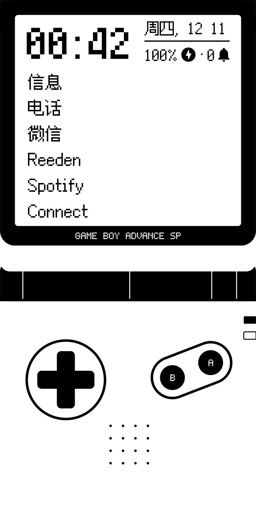
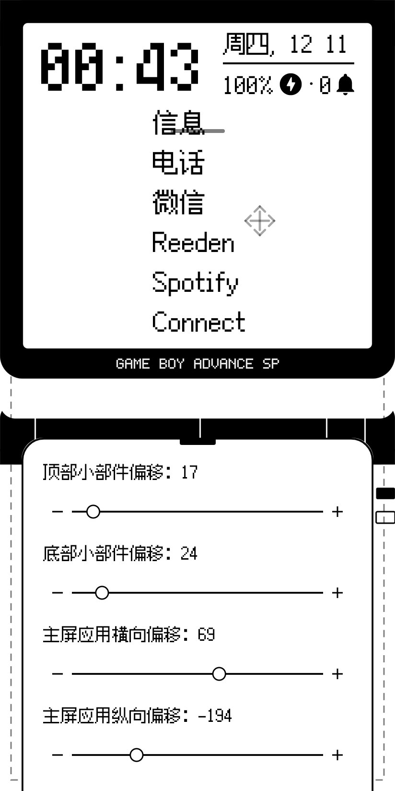
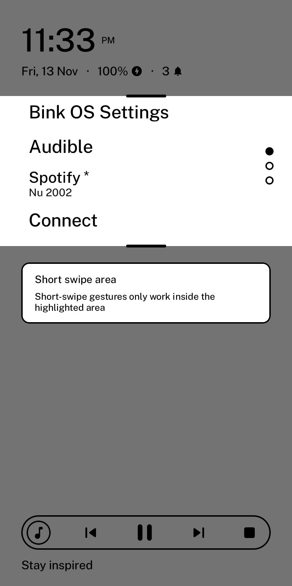
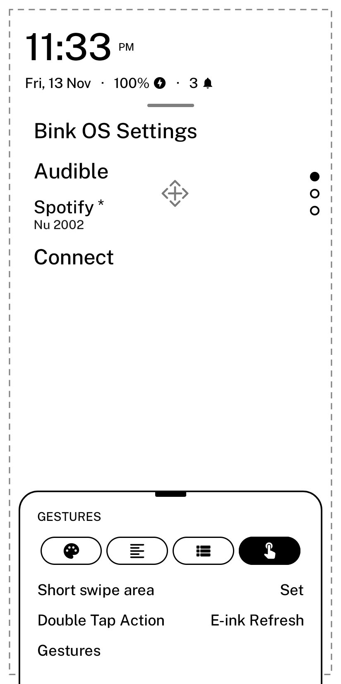
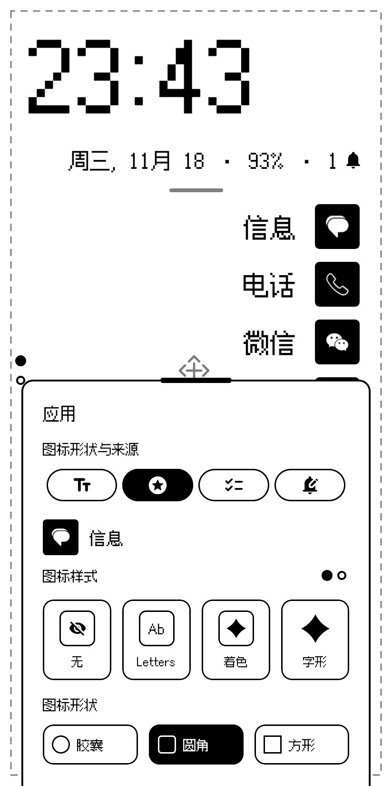
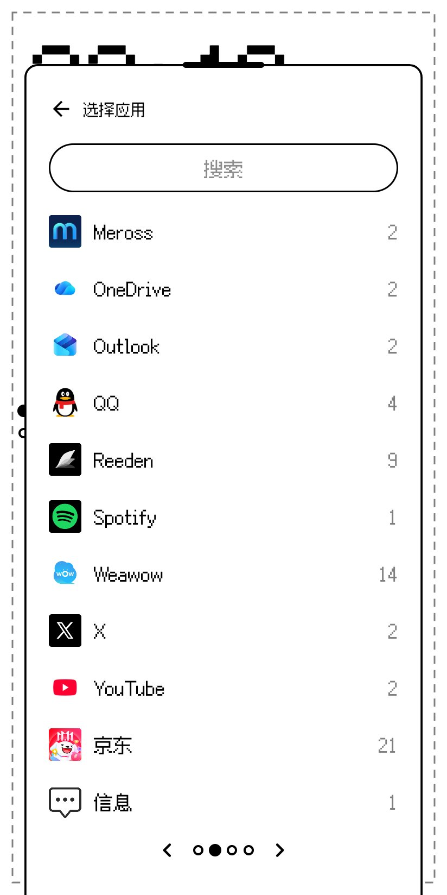
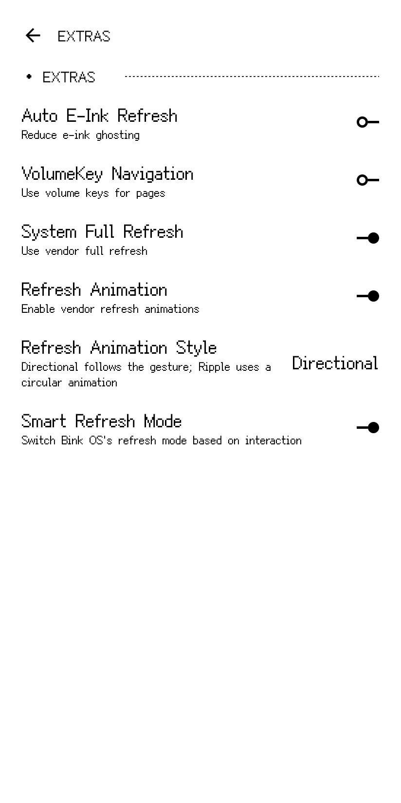
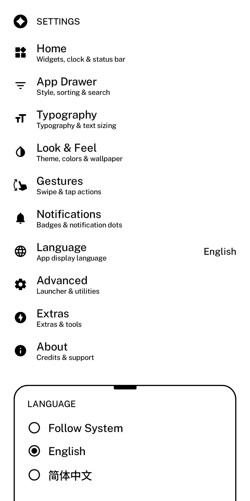

<div align="center">
  
  <h1>Bink OS</h1>
  <p><b>A text-first, e-ink tuned Android launcher for the Bigme HiBreak.</b><br>
  A personal fork of <a href="https://github.com/gezimos/inkOS">inkOS</a>, tuned so the HiBreak feels native.</p>
  <p>
    <a href="https://github.com/MercShen/BinkOS/releases">Download APK</a> ·
    <a href="DOCUMENTATION.md">Documentation</a>
  </p>
  <p>
    <a href="README.md">English</a> · <a href="README.zh-CN.md">简体中文</a>
  </p>
  <table>
    <tr>
      <td align="center">
        <br>
        <sub>Text-first home — freely place your home apps where you want them</sub>
      </td>
      <td align="center">
        <br>
        <sub>Live layout editor — margins, offsets, hold-to-repeat steppers</sub>
      </td>
    </tr>
    <tr>
      <td align="center">
        <br>
        <sub>Short swipe zone — short swipe gestures register only where you want them</sub>
      </td>
      <td align="center">
        <br>
        <sub>Gestures quick panel — Try out and customize the new short swipe area in edit mode </sub>
      </td>
    </tr>
    <tr>
      <td align="center">
        <br>
        <sub>Icon style — text-only or icons, with a live preview</sub>
      </td>
      <td align="center">
        <br>
        <sub>Widget picker — search by name, paged navigation for e-ink</sub>
      </td>
    </tr>
    <tr>
      <td align="center">
        <br>
        <sub>Bigme refresh, animation style &amp; Smart Refresh switches</sub>
      </td>
      <td align="center">
        <br>
        <sub>Settings — app language, 简体中文 included</sub>
      </td>
    </tr>
  </table>
</div>

Bink OS keeps inkOS's text-first home screen and adds features and quality-of-life improvements for e-ink use. It is a launcher for reading, notes and light apps on an e-ink phone.

## Bink OS Unique features

### Bigme HiBreak integration
These features will be available to you if you device is Bigme Hibreak series. (*Refresh animations will require a newer firmware that shows **page-turn animations** inside E-ink center to work)
- **Vendor GC16 full refresh** — use the vendor's GC16 full refresh instead of the app's own full-screen flash, which cuts ghosting.
- **Refresh animation** — use the Bigme e-ink page-turn effect while navigating Bink OS; Directional and Circular Ripple styles (Ripple since v0.2.7).
- **Smart Refresh Mode** (Settings → Extras, off by default) — keep Regal as the default and switch to the vendor's Extreme refresh while you scroll or drag in edit mode and the short-swipe zone editor, then go back to Regal when they close, so dragging and scrolling keeps up without giving up crisp text or page-turn animations elsewhere.

### Gestures that don't fight the system
- **Short swipe area** — restrict page-turn short swipes to a configurable band, so system edge gestures still work; fewer conflicts on devices using gesture navigation.
- **Reverse long swipe closes** — a surface bound to a long-swipe gesture (app drawer, recents, Letters, Hub, Simple Tray, settings) closes with the long swipe opposite to the one that opened it. Surfaces with no bound opening gesture (for example Settings opened from its icon) do not exit on a long swipe.

### Home app placement
- Drag and drop home apps freely, or use the margin and offset editor in edit mode: margins on each edge plus a vertical offset, so the layout can fit custom wallpapers easily.

### Localization ready
- **Simplified Chinese is fully supported** — the whole UI is translated (zh-CN), the app has its own language picker, and Bink OS internal shortcuts (drawer, Letters, Simple Tray, Hub, recents, settings) follow the in-app language instead of the system one.
- **CJK and pixel-font fixes** — glyph clipping and pixel snapping for pixel fonts.
- Translating or changing UI copy? Read the [terminology & localization guide](docs/terminology.md) first; `python tools/check-locales.py` keeps EN/ZH keys and placeholders in sync.

## Quality-of-life improvements
- **Backup & restore** — ZIP backup now also carries imported fonts and custom wallpapers, restorable from Settings.
- **Searchable allowlists** — the app picker for Letters, Simple Tray, Hub and badge notification allowlists has a search box.
- **Paged navigation** — consistent paging in more menus for a better e-ink experience.
- **Pinyin search** in the app drawer.
- **Widget picking** — preview and swap different widgets of one app from a single picker.
- **Icon customization** — streamlined menus with a live preview.
- **Edit mode** — each panel now states what you are editing.

## Install

Download the signed APK from [Releases](https://github.com/MercShen/BinkOS/releases) and install it over an existing Bink OS build — the signing key is stable, so upgrades keep your data.

Requires Android 8.0+ (API 26). Best on the Bigme HiBreak; other e-ink phones work, and the vendor switches only appear on devices that actually expose the vendor e-ink API.

## Build

```bash
./gradlew assembleRelease
```

Needs Android SDK 36 and JDK 17. Release signing reads `KEYSTORE_FILE`, `KEYSTORE_PASSWORD`, `KEY_ALIAS` and `KEY_PASSWORD` from the environment.

## Credits

Bink OS is a fork of [inkOS](https://github.com/gezimos/inkOS) by gezimos — all the original launcher design and most of the feature set come from there. inkOS itself descends from mLauncher / oLauncher.

Licensed under GPL-3.0, same as upstream.

