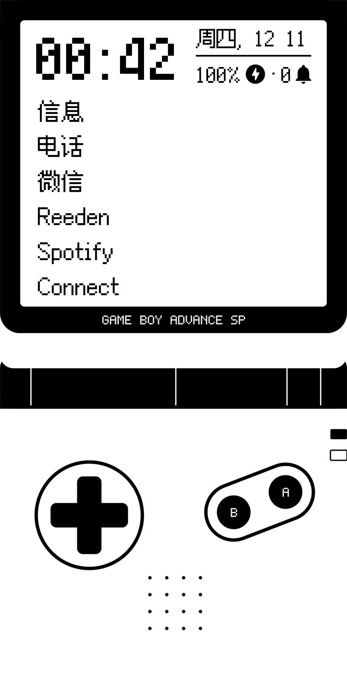
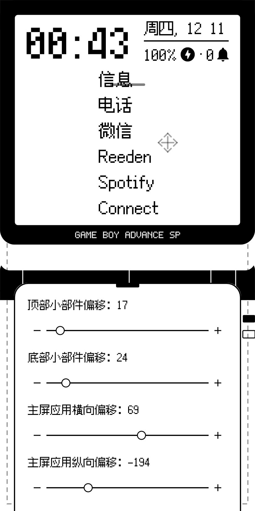
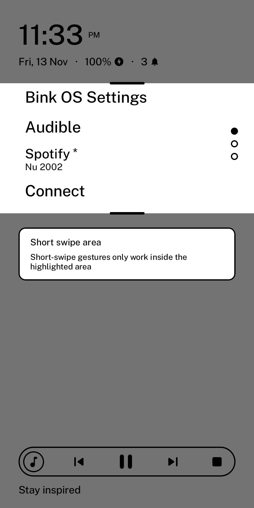
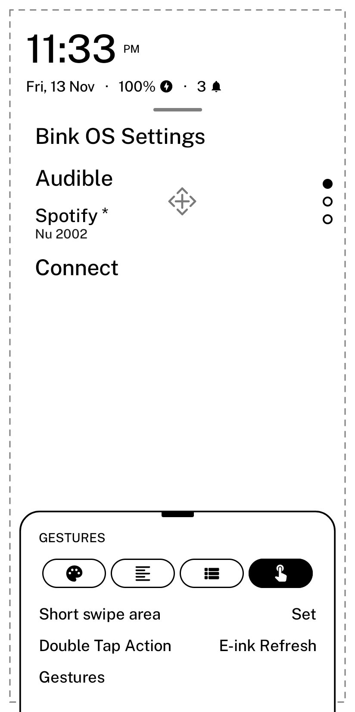
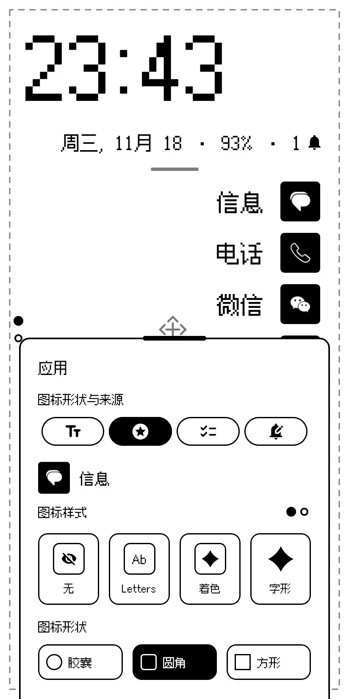
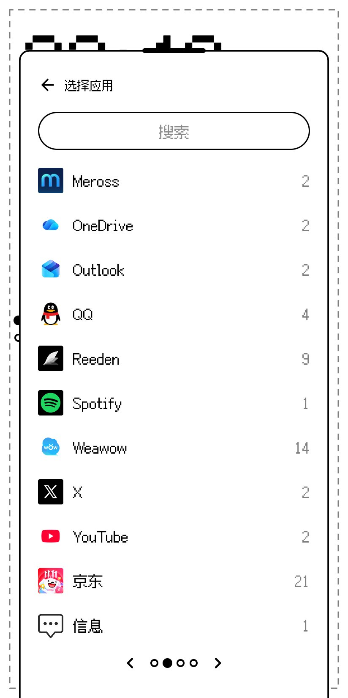
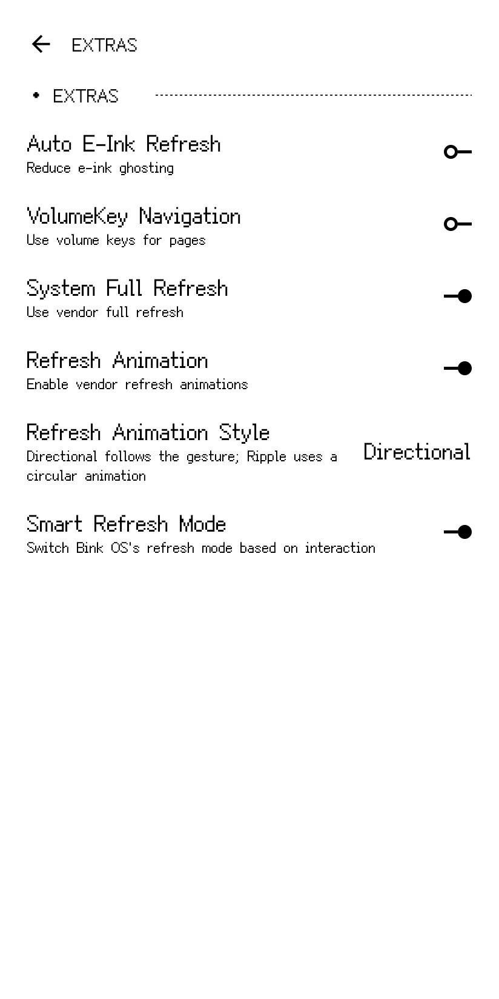
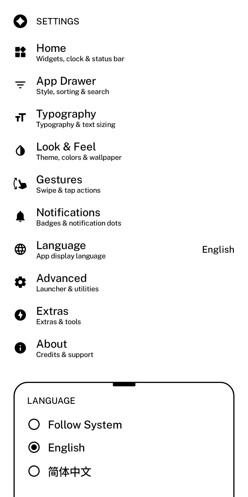

<div align="center">
  
  <h1>Bink OS</h1>
  <p><b>为 Bigme HiBreak 打造的文字优先、墨水屏优化的 Android 桌面。</b><br>
  <a href="https://github.com/gezimos/inkOS">inkOS</a> 的个人分支，针对 HiBreak 做了本地化调优。</p>
  <p>
    <a href="https://github.com/MercShen/BinkOS/releases">下载 APK</a> ·
    <a href="DOCUMENTATION.md">文档</a>
  </p>
  <p>
    <a href="README.md">English</a> · <a href="README.zh-CN.md">简体中文</a>
  </p>
  <table>
    <tr>
      <td align="center">
        <br>
        <sub>文字优先的首页 —— 应用想放哪就放哪</sub>
      </td>
      <td align="center">
        <br>
        <sub>就地布局编辑 —— 边距、偏移、长按加速步进</sub>
      </td>
    </tr>
    <tr>
      <td align="center">
        <br>
        <sub>短滑区域 —— 短滑手势只在你想让它生效的地方生效</sub>
      </td>
      <td align="center">
        <br>
        <sub>手势快捷面板 —— 滑动、双击与短滑区域一处设置</sub>
      </td>
    </tr>
    <tr>
      <td align="center">
        <br>
        <sub>图标样式 —— 纯文字或图标，实时预览</sub>
      </td>
      <td align="center">
        <br>
        <sub>小部件选择器 —— 按名称搜索，分页翻动</sub>
      </td>
    </tr>
    <tr>
      <td align="center">
        <br>
        <sub>大我刷新、翻页动画风格与智能刷新开关</sub>
      </td>
      <td align="center">
        <br>
        <sub>设置 —— 应用内语言，含简体中文</sub>
      </td>
    </tr>
  </table>
</div>

Bink OS 保留了 inkOS 的文字优先首页，并加入了面向墨水屏的功能与体验改进。它是一台墨水屏手机用来阅读、记事和跑轻量应用的桌面。

## Bink OS 独有特性

### 大我 HiBreak 深度集成
- **厂商 GC16 全刷** —— 用厂商 GC16 全刷代替应用自己的整屏闪烁，减少残影。
- **刷新动画** —— 在 Bink OS 内导航时播放大我的墨水屏翻页效果；提供 Directional 与 Circular Ripple 两种风格（Ripple 自 v0.2.7 起）。
- **智能刷新模式**（设置 → 更多功能，默认关）—— 默认保持 Regal；在编辑模式与短滑区域编辑器里拖动/滚动时切换到厂商的 Extreme 刷新，关闭后回到 Regal，拖动跟手的同时文字保持清晰、其它界面的翻页动画照常。

### 不和系统打架的手势
- **短滑区域** —— 把翻页短滑限制在可配置的条带内，系统边缘手势照常可用；在使用系统手势导航的设备上冲突更少。
- **反向长滑关闭** —— 只有绑定了长滑打开手势的界面（应用抽屉、最近任务、Letters、Hub、Simple Tray、设置）才用「打开方向的相反长滑」关闭。未绑定打开手势的界面（例如从图标进入的设置）不会因长滑退出。

### 主屏应用位置
- 自由拖放主屏应用，或在编辑模式里用边距/位移编辑器：四边边距加一个纵向位移，让布局更容易适配自定义壁纸。

### 本地化就绪
- **完整支持简体中文** —— 整个界面已翻译（zh-CN），应用内有独立语言选择器，Bink OS 的内部快捷方式（抽屉、Letters、Simple Tray、Hub、最近任务、设置）跟随应用内语言，而不是系统语言。
- **CJK 与像素字体修复** —— 修复字形裁切，并让像素字体对齐整数像素。
- 翻译或修改界面文案前先读[术语与本地化指南](docs/terminology.md)；`python tools/check-locales.py` 用来保持中英 key 与占位符一致。

## 体验改进
- **备份与恢复** —— ZIP 备份现在还带上导入的字体与自定义壁纸，可随时从设置里恢复。
- **白名单搜索** —— Letters、Simple Tray、Hub 与角标通知的白名单应用选择器带搜索框。
- **分页导航** —— 更多菜单统一按页切换，墨水屏上更好用。
- **应用抽屉支持拼音搜索**。
- **组件选择** —— 同一个应用的不同组件可以在一个选择器里预览并替换。
- **图标自定义** —— 更精简的菜单，带实时预览。
- **编辑模式** —— 每个面板现在都会写明你正在编辑什么。

## 安装

从 [Releases](https://github.com/MercShen/BinkOS/releases) 下载签名 APK，可直接覆盖旧版安装 —— 签名密钥固定，升级不丢数据。

需要 Android 8.0+（API 26）。在 Bigme HiBreak 上体验最好；其它墨水屏手机也能用，大我专属开关只在设备确实提供厂商墨水屏接口时出现。

## 构建

```bash
./gradlew assembleRelease
```

需要 Android SDK 36 和 JDK 17。Release 签名从环境变量读取 `KEYSTORE_FILE`、`KEYSTORE_PASSWORD`、`KEY_ALIAS`、`KEY_PASSWORD`。

## 致谢

Bink OS 是 gezimos 的 [inkOS](https://github.com/gezimos/inkOS) 的分支 —— 原本的桌面设计与大部分功能都来自那里。inkOS 本身源自 mLauncher / oLauncher。

与上游一致，采用 GPL-3.0 协议。

