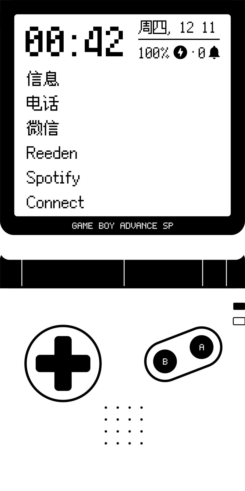
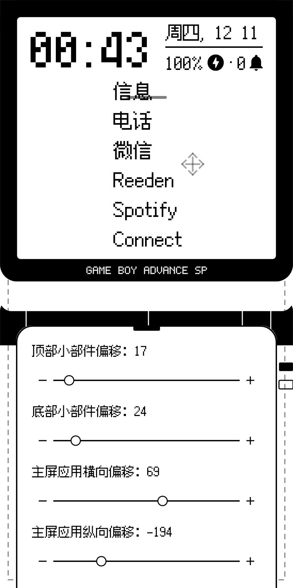
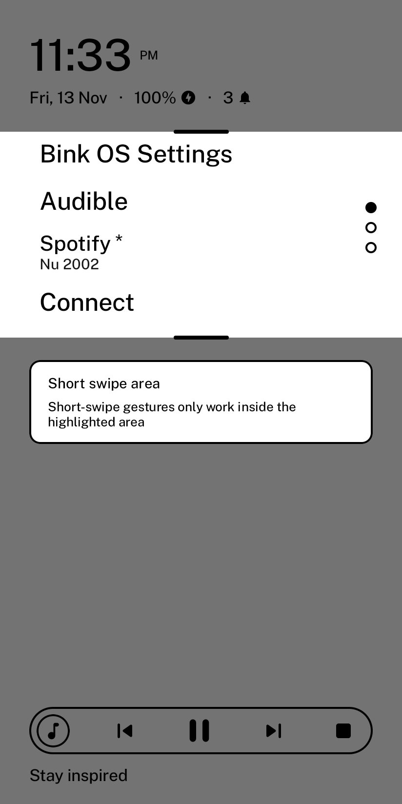
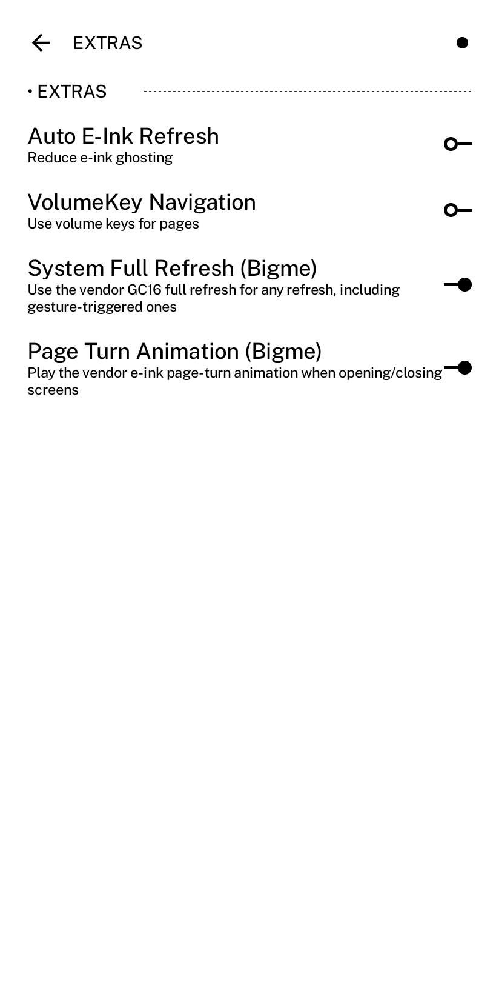
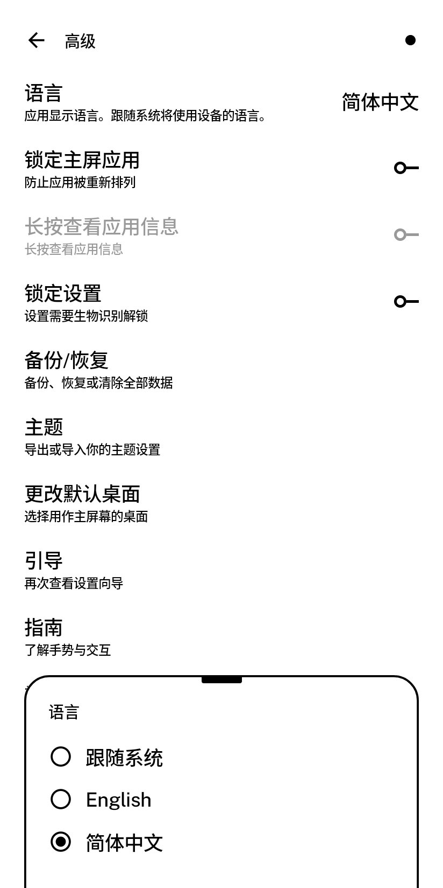

<div align="center">
  
  <h1>Bink OS</h1>
  <p><b>为 Bigme HiBreak 打造的文字优先、墨水屏优化的 Android 桌面。</b><br>
  <a href="https://github.com/gezimos/inkOS">inkOS</a> 的个人分支，针对 HiBreak 做了本地化调优。</p>
  <p>
    <a href="https://github.com/MercShen/BinkOS/releases">下载 APK</a> ·
    <a href="DOCUMENTATION.md">文档</a>
  </p>
  <p>
    <a href="README.md">English</a> · <a href="README.zh-CN.md">简体中文</a>
  </p>
  <table>
    <tr>
      <td align="center">
        <br>
        <sub>文字优先的首页 —— 应用想放哪就放哪</sub>
      </td>
      <td align="center">
        <br>
        <sub>就地布局编辑 —— 边距、偏移、长按加速步进</sub>
      </td>
    </tr>
    <tr>
      <td align="center">
        <br>
        <sub>短滑区域 —— 短滑手势只在你想让它生效的地方生效</sub>
      </td>
      <td align="center">
        <br>
        <sub>大我刷新与翻页动画开关</sub>
      </td>
    </tr>
    <tr>
      <td colspan="2" align="center">
        <br>
        <sub>语言选择器 —— 已支持简体中文</sub>
      </td>
    </tr>
  </table>
</div>

Bink OS 保留了 inkOS 的文字优先首页，并重做了与墨水屏硬件摩擦的部分：手势、刷新、排版与布局。它不是通用桌面，而是一台墨水屏手机用来阅读、记事和跑轻量应用的桌面。

## 独有特性

### 大我 HiBreak 深度集成
- **厂商 GC16 全刷** —— 任何一次刷新（包括手势触发的）都可以强制走厂商全刷。
- **厂商翻页动画** —— 开关界面时播放 Bigme 的墨水屏翻页效果。
- **刷新策略控制** —— 自动刷新、仅主页刷新、可配置的刷新间隔。

### 不和系统打架的手势
- **短滑区域** —— 把翻页短滑限制在可配置的上下边界内，系统边缘手势（回桌面 / 返回）照常可用。编辑模式下有实时预览：左右手柄、虚线边界；区域从 30dp 起算，不会被状态栏挡住。
- **反向长滑关闭** —— 每个界面（应用抽屉、最近任务、信笺、中枢、简易托盘、设置）都用「打开方向的相反长滑」关闭。检测放在指针事件的 Initial pass，内层滚动不会吞掉手势。
- **可绑定 15+ 动作** —— 4 个滑动方向、双击，以及点击时钟/日期/引言。

### 为墨水屏而做的排版
- 分元素字体：时钟、日期、应用名、引言、通知、设置各自独立字体与字号。
- 支持自定义 `.ttf` / `.otf`，包括在整数倍缩放下依然锐利的像素字体。
- 文字岛、全大写/小型大写应用名、逐元素对齐。

### 不用翻菜单的布局
- **编辑模式** —— 直接点首页上的元素就地修改。
- 对齐、边距、偏移集中在同一个对话框里，带拖动手柄和长按加速步进，范围就是布局真正能用的范围。

### 本地化就绪
- **完整支持简体中文** —— 整个界面已翻译（zh-CN），应用内有独立语言选择器，inkOS 的内部快捷方式（抽屉、信笺、托盘、中枢、最近任务、设置）跟随应用内语言，而不是系统语言。

### 备份与恢复
- ZIP 备份包含布局、别名、偏好设置与壁纸，可随时从设置里恢复。

## 优化

- 手势检测放在指针事件的 Initial pass，长滑不会被可滚动内容吃掉。
- 短滑区域避免翻页手势与厂商边缘手势互相抢。
- 全刷路径降低墨水屏残影，同时保留局部快刷。
- 修复 CJK 字形裁切，并让像素字体对齐整数像素。
- 应用抽屉支持拼音搜索、A-Z 索引、隐藏应用与私密空间。

## 安装

从 [Releases](https://github.com/MercShen/BinkOS/releases) 下载签名 APK，可直接覆盖旧版安装 —— 签名密钥固定，升级不丢数据。

需要 Android 10+。在 Bigme HiBreak 上体验最好；其它墨水屏手机也能用，但大我专属开关只对 HiBreak 生效。

## 构建

```bash
./gradlew assembleRelease
```

需要 Android SDK 36 和 JDK 17。Release 签名从环境变量读取 `KEYSTORE_FILE`、`KEYSTORE_PASSWORD`、`KEY_ALIAS`、`KEY_PASSWORD`。

## 致谢

Bink OS 是 gezimos 的 [inkOS](https://github.com/gezimos/inkOS) 的分支 —— 原本的桌面设计与大部分功能都来自那里。inkOS 本身源自 mLauncher / oLauncher。

与上游一致，采用 GPL-3.0 协议。

